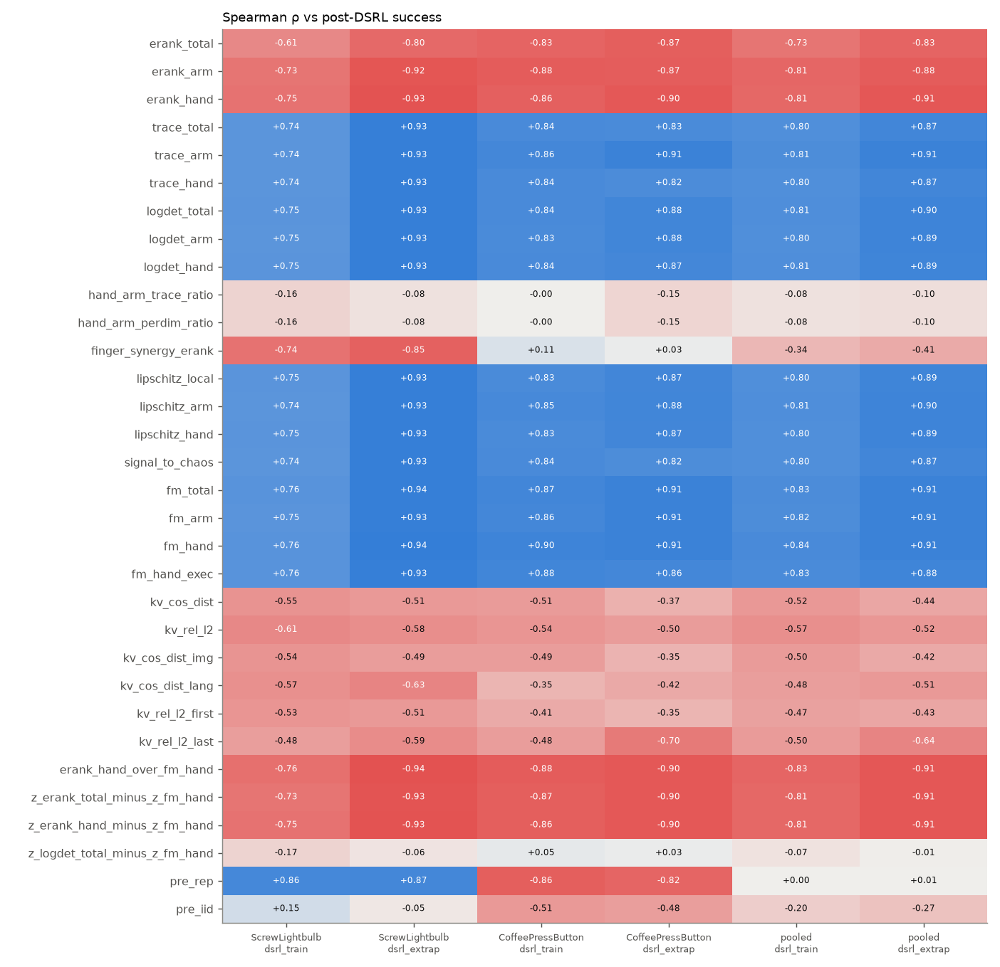

# Offline steerability metrics vs post-DSRL success

Checkpoints evaluated: {'CoffeePressButton': 20, 'ScrewLightbulb': 20} (of 20 per task). Per checkpoint: 32 demo observations, M = 64 DSRL noises w ~ box [-1,1]^32 tiled over the 32-step chunk, 16 Lipschitz perturbations (σ_δ = 0.05), 16 flow-matching (τ, ε) samples; the same observations and noises for every checkpoint of a task.

How to read this:
- n = 20 per task, and about 30 metrics are tested against 2 targets in 3 scopes. With that many tests, |ρ| ≈ 0.45 (p ≈ 0.05) can happen by chance, so look for metrics that hold up in both tasks and in the pooled scope.
- **Bold** rows are the rollout-based baselines (`pre_rep` = SFT success with repeated noise, `pre_iid` = with iid noise). An offline metric is only useful if it adds information beyond them. The last column, partial ρ given pre_rep, measures exactly that.
- SFT step alone correlates negatively with DSRL success (more SFT, less steerable), and most metrics drift with step. Two controls separate a metric from training length: **partial ρ given SFT step**, and **within-step ρ**, which compares only the 5 recipes at the same step rung.
- Most action metrics (flow-matching loss, trace, logdet, Lipschitz gain, eRank) move together, so read them as one factor: how strongly the decoded action still responds to the noise. eRank is scale-invariant, and it *rises* as the response collapses toward small isotropic jitter, so its negative sign is expected.
- `pooled` ranks each metric and each target within its task first, so the two tasks' different scales don't create spurious correlation (n = 40).
- The demo episodes were all used for SFT (neither dataset has a held-out split), so the flow-matching loss is measured on training data, not on validation data.

## Headline: strongest offline metric per scope and target

| scope | target | best offline metric | ρ | p | partial ρ given pre_rep | pre_rep ρ |
|---|---|---|---:|---:|---:|---:|
| CoffeePressButton | dsrl_train | fm_hand | +0.90 | 8.1e-08 | +0.52 | -0.86 |
| CoffeePressButton | dsrl_extrap | fm_arm | +0.91 | 2.1e-08 | +0.70 | -0.82 |
| ScrewLightbulb | dsrl_train | erank_hand_over_fm_hand | -0.76 | 0.00011 | -0.52 | +0.84 |
| ScrewLightbulb | dsrl_extrap | erank_hand_over_fm_hand | -0.94 | 6.5e-10 | -0.90 | +0.71 |
| pooled | dsrl_train | fm_hand | +0.84 | 1.7e-11 | +0.84 | -0.01 |
| pooled | dsrl_extrap | fm_hand | +0.91 | 2e-16 | +0.91 | -0.07 |

## ScrewLightbulb: dsrl_train

| rank | metric | group | Spearman ρ | p | Kendall τ | p | partial ρ given pre_rep | partial ρ given SFT step | within-step ρ |
|---:|---|---|---:|---:|---:|---:|---:|---:|---:|
| 1 | **pre_rep** | baseline (rollouts) | +0.84 | 4.35e-06 | +0.69 | 6.64e-05 | n/a | +0.77 | +0.65 |
| 2 | fm_hand | 4 flow-matching loss | +0.76 | 0.000107 | +0.55 | 0.00121 | +0.52 | +0.67 | +0.31 |
| 3 | fm_total | 4 flow-matching loss | +0.76 | 0.000107 | +0.55 | 0.00121 | +0.51 | +0.67 | +0.31 |
| 4 | fm_hand_exec | 4 flow-matching loss | +0.76 | 0.000107 | +0.55 | 0.00121 | +0.51 | +0.68 | +0.31 |
| 5 | erank_hand_over_fm_hand | 6 composite | -0.76 | 0.000107 | -0.55 | 0.00121 | -0.52 | -0.67 | -0.31 |
| 6 | logdet_total | 1 latent-to-action rank | +0.75 | 0.000122 | +0.55 | 0.00121 | +0.53 | +0.66 | +0.30 |
| 7 | fm_arm | 4 flow-matching loss | +0.75 | 0.000122 | +0.55 | 0.00121 | +0.51 | +0.65 | +0.25 |
| 8 | logdet_hand | 1 latent-to-action rank | +0.75 | 0.000122 | +0.55 | 0.00121 | +0.53 | +0.66 | +0.30 |
| 9 | lipschitz_local | 3 smoothness | +0.75 | 0.000135 | +0.55 | 0.00121 | +0.53 | +0.66 | +0.24 |
| 10 | lipschitz_hand | 3 smoothness | +0.75 | 0.000135 | +0.55 | 0.00121 | +0.53 | +0.66 | +0.24 |
| 11 | erank_hand | 1 latent-to-action rank | -0.75 | 0.000142 | -0.55 | 0.00121 | -0.56 | -0.64 | -0.23 |
| 12 | logdet_arm | 1 latent-to-action rank | +0.75 | 0.000149 | +0.54 | 0.00153 | +0.50 | +0.65 | +0.25 |
| 13 | z_erank_hand_minus_z_fm_hand | 6 composite | -0.75 | 0.000153 | -0.53 | 0.00193 | -0.52 | -0.64 | -0.17 |
| 14 | signal_to_chaos | 3 smoothness | +0.74 | 0.000165 | +0.53 | 0.00193 | +0.51 | +0.64 | +0.18 |
| 15 | trace_hand | 1 latent-to-action rank | +0.74 | 0.000165 | +0.53 | 0.00193 | +0.51 | +0.64 | +0.18 |
| 16 | trace_total | 1 latent-to-action rank | +0.74 | 0.000165 | +0.53 | 0.00193 | +0.51 | +0.64 | +0.18 |
| 17 | lipschitz_arm | 3 smoothness | +0.74 | 0.000165 | +0.53 | 0.00193 | +0.51 | +0.64 | +0.18 |
| 18 | trace_arm | 1 latent-to-action rank | +0.74 | 0.000165 | +0.53 | 0.00193 | +0.51 | +0.64 | +0.18 |
| 19 | finger_synergy_erank | 2 finger vs arm | -0.74 | 0.000169 | -0.57 | 0.000955 | -0.51 | -0.64 | -0.32 |
| 20 | z_erank_total_minus_z_fm_hand | 6 composite | -0.73 | 0.00023 | -0.54 | 0.00153 | -0.51 | -0.62 | -0.23 |
| 21 | erank_arm | 1 latent-to-action rank | -0.73 | 0.000252 | -0.51 | 0.00301 | -0.47 | -0.62 | -0.21 |
| 22 | kv_rel_l2 | 5 KV drift vs base | -0.61 | 0.00403 | -0.48 | 0.0055 | -0.34 | -0.55 | -0.46 |
| 23 | erank_total | 1 latent-to-action rank | -0.61 | 0.00421 | -0.47 | 0.00571 | -0.42 | -0.43 | -0.30 |
| 24 | kv_cos_dist_lang | 5 KV drift vs base | -0.57 | 0.00875 | -0.43 | 0.0122 | -0.43 | -0.53 | -0.49 |
| 25 | kv_cos_dist | 5 KV drift vs base | -0.55 | 0.0123 | -0.41 | 0.0178 | -0.31 | -0.50 | -0.43 |
| 26 | kv_cos_dist_img | 5 KV drift vs base | -0.54 | 0.0142 | -0.41 | 0.0178 | -0.30 | -0.50 | -0.43 |
| 27 | kv_rel_l2_first | 5 KV drift vs base | -0.53 | 0.0152 | -0.39 | 0.0255 | -0.30 | -0.49 | -0.43 |
| 28 | kv_rel_l2_last | 5 KV drift vs base | -0.48 | 0.0323 | -0.36 | 0.0358 | -0.41 | -0.44 | -0.45 |
| 29 | **pre_iid** | baseline (rollouts) | +0.27 | 0.248 | +0.22 | 0.235 | +0.08 | +0.56 | +0.44 |
| 30 | z_logdet_total_minus_z_fm_hand | 6 composite | -0.17 | 0.487 | -0.10 | 0.544 | +0.18 | -0.19 | -0.12 |
| 31 | hand_arm_trace_ratio | 2 finger vs arm | -0.16 | 0.489 | -0.12 | 0.5 | -0.03 | -0.40 | +0.01 |
| 32 | hand_arm_perdim_ratio | 2 finger vs arm | -0.16 | 0.489 | -0.12 | 0.5 | -0.03 | -0.40 | +0.01 |

## ScrewLightbulb: dsrl_extrap

| rank | metric | group | Spearman ρ | p | Kendall τ | p | partial ρ given pre_rep | partial ρ given SFT step | within-step ρ |
|---:|---|---|---:|---:|---:|---:|---:|---:|---:|
| 1 | erank_hand_over_fm_hand | 6 composite | -0.94 | 6.54e-10 | -0.83 | 1.07e-06 | -0.90 | -0.87 | -0.69 |
| 2 | fm_hand | 4 flow-matching loss | +0.94 | 6.54e-10 | +0.83 | 1.07e-06 | +0.90 | +0.87 | +0.69 |
| 3 | fm_total | 4 flow-matching loss | +0.94 | 1.15e-09 | +0.82 | 1.51e-06 | +0.89 | +0.86 | +0.69 |
| 4 | erank_hand | 1 latent-to-action rank | -0.93 | 1.58e-09 | -0.79 | 2.93e-06 | -0.90 | -0.86 | -0.56 |
| 5 | logdet_total | 1 latent-to-action rank | +0.93 | 1.58e-09 | +0.79 | 2.93e-06 | +0.89 | +0.85 | +0.69 |
| 6 | logdet_arm | 1 latent-to-action rank | +0.93 | 1.58e-09 | +0.79 | 2.93e-06 | +0.89 | +0.85 | +0.69 |
| 7 | lipschitz_local | 3 smoothness | +0.93 | 1.75e-09 | +0.79 | 2.93e-06 | +0.89 | +0.85 | +0.64 |
| 8 | lipschitz_hand | 3 smoothness | +0.93 | 1.75e-09 | +0.79 | 2.93e-06 | +0.89 | +0.85 | +0.64 |
| 9 | logdet_hand | 1 latent-to-action rank | +0.93 | 1.94e-09 | +0.78 | 4.05e-06 | +0.89 | +0.85 | +0.68 |
| 10 | signal_to_chaos | 3 smoothness | +0.93 | 2.15e-09 | +0.78 | 4.05e-06 | +0.89 | +0.85 | +0.62 |
| 11 | trace_arm | 1 latent-to-action rank | +0.93 | 2.15e-09 | +0.78 | 4.05e-06 | +0.89 | +0.85 | +0.62 |
| 12 | trace_total | 1 latent-to-action rank | +0.93 | 2.15e-09 | +0.78 | 4.05e-06 | +0.89 | +0.85 | +0.62 |
| 13 | fm_arm | 4 flow-matching loss | +0.93 | 2.15e-09 | +0.79 | 2.93e-06 | +0.88 | +0.85 | +0.60 |
| 14 | lipschitz_arm | 3 smoothness | +0.93 | 2.15e-09 | +0.78 | 4.05e-06 | +0.89 | +0.85 | +0.62 |
| 15 | trace_hand | 1 latent-to-action rank | +0.93 | 2.15e-09 | +0.78 | 4.05e-06 | +0.89 | +0.85 | +0.62 |
| 16 | fm_hand_exec | 4 flow-matching loss | +0.93 | 2.37e-09 | +0.82 | 1.51e-06 | +0.88 | +0.85 | +0.69 |
| 17 | z_erank_hand_minus_z_fm_hand | 6 composite | -0.93 | 2.62e-09 | -0.79 | 2.93e-06 | -0.89 | -0.84 | -0.56 |
| 18 | z_erank_total_minus_z_fm_hand | 6 composite | -0.93 | 4.23e-09 | -0.78 | 4.05e-06 | -0.88 | -0.83 | -0.48 |
| 19 | erank_arm | 1 latent-to-action rank | -0.92 | 1.54e-08 | -0.77 | 5.59e-06 | -0.85 | -0.81 | -0.66 |
| 20 | finger_synergy_erank | 2 finger vs arm | -0.85 | 2.07e-06 | -0.68 | 6.25e-05 | -0.74 | -0.79 | -0.52 |
| 21 | erank_total | 1 latent-to-action rank | -0.80 | 2.11e-05 | -0.63 | 0.000188 | -0.74 | -0.65 | -0.52 |
| 22 | **pre_rep** | baseline (rollouts) | +0.71 | 0.000473 | +0.57 | 0.000839 | n/a | +0.55 | +0.44 |
| 23 | kv_cos_dist_lang | 5 KV drift vs base | -0.63 | 0.00269 | -0.51 | 0.00329 | -0.52 | -0.68 | -0.62 |
| 24 | kv_rel_l2_last | 5 KV drift vs base | -0.59 | 0.00583 | -0.47 | 0.00621 | -0.55 | -0.66 | -0.64 |
| 25 | kv_rel_l2 | 5 KV drift vs base | -0.58 | 0.00725 | -0.46 | 0.00761 | -0.32 | -0.53 | -0.25 |
| 26 | kv_rel_l2_first | 5 KV drift vs base | -0.51 | 0.0214 | -0.42 | 0.0136 | -0.29 | -0.50 | -0.33 |
| 27 | kv_cos_dist | 5 KV drift vs base | -0.51 | 0.0221 | -0.40 | 0.0197 | -0.27 | -0.48 | -0.25 |
| 28 | kv_cos_dist_img | 5 KV drift vs base | -0.49 | 0.0294 | -0.39 | 0.0236 | -0.25 | -0.48 | -0.25 |
| 29 | hand_arm_trace_ratio | 2 finger vs arm | -0.08 | 0.735 | -0.06 | 0.711 | +0.06 | -0.48 | -0.48 |
| 30 | hand_arm_perdim_ratio | 2 finger vs arm | -0.08 | 0.735 | -0.06 | 0.711 | +0.06 | -0.48 | -0.48 |
| 31 | z_logdet_total_minus_z_fm_hand | 6 composite | -0.06 | 0.79 | -0.03 | 0.866 | +0.23 | -0.09 | -0.32 |
| 32 | **pre_iid** | baseline (rollouts) | -0.00 | 0.994 | +0.00 | 1 | -0.29 | +0.39 | +0.21 |

## CoffeePressButton: dsrl_train

| rank | metric | group | Spearman ρ | p | Kendall τ | p | partial ρ given pre_rep | partial ρ given SFT step | within-step ρ |
|---:|---|---|---:|---:|---:|---:|---:|---:|---:|
| 1 | fm_hand | 4 flow-matching loss | +0.90 | 8.09e-08 | +0.77 | 3.49e-06 | +0.52 | +0.81 | +0.63 |
| 2 | erank_hand_over_fm_hand | 6 composite | -0.88 | 2.79e-07 | -0.75 | 6.51e-06 | -0.45 | -0.80 | -0.63 |
| 3 | erank_arm | 1 latent-to-action rank | -0.88 | 3.11e-07 | -0.74 | 8.84e-06 | -0.54 | -0.72 | -0.61 |
| 4 | fm_hand_exec | 4 flow-matching loss | +0.88 | 3.28e-07 | +0.75 | 6.51e-06 | +0.49 | +0.79 | +0.63 |
| 5 | fm_total | 4 flow-matching loss | +0.87 | 4.98e-07 | +0.74 | 8.84e-06 | +0.43 | +0.79 | +0.63 |
| 6 | z_erank_total_minus_z_fm_hand | 6 composite | -0.87 | 7.77e-07 | -0.72 | 1.2e-05 | -0.40 | -0.80 | -0.66 |
| 7 | **pre_rep** | baseline (rollouts) | -0.86 | 8.91e-07 | -0.69 | 3.68e-05 | n/a | -0.77 | -0.59 |
| 8 | trace_arm | 1 latent-to-action rank | +0.86 | 9.4e-07 | +0.70 | 2.16e-05 | +0.29 | +0.76 | +0.50 |
| 9 | z_erank_hand_minus_z_fm_hand | 6 composite | -0.86 | 9.85e-07 | -0.72 | 1.2e-05 | -0.39 | -0.79 | -0.66 |
| 10 | fm_arm | 4 flow-matching loss | +0.86 | 1.08e-06 | +0.71 | 1.61e-05 | +0.38 | +0.77 | +0.62 |
| 11 | erank_hand | 1 latent-to-action rank | -0.86 | 1.55e-06 | -0.70 | 2.16e-05 | -0.39 | -0.79 | -0.66 |
| 12 | lipschitz_arm | 3 smoothness | +0.85 | 2.1e-06 | +0.68 | 3.84e-05 | +0.22 | +0.73 | +0.36 |
| 13 | logdet_hand | 1 latent-to-action rank | +0.84 | 3.44e-06 | +0.66 | 6.71e-05 | +0.18 | +0.71 | +0.31 |
| 14 | signal_to_chaos | 3 smoothness | +0.84 | 3.44e-06 | +0.68 | 3.84e-05 | +0.31 | +0.69 | +0.51 |
| 15 | trace_total | 1 latent-to-action rank | +0.84 | 3.58e-06 | +0.67 | 5.09e-05 | +0.22 | +0.69 | +0.43 |
| 16 | logdet_total | 1 latent-to-action rank | +0.84 | 4.03e-06 | +0.65 | 8.82e-05 | +0.14 | +0.70 | +0.30 |
| 17 | trace_hand | 1 latent-to-action rank | +0.84 | 4.19e-06 | +0.66 | 6.71e-05 | +0.24 | +0.68 | +0.43 |
| 18 | erank_total | 1 latent-to-action rank | -0.83 | 4.7e-06 | -0.69 | 2.89e-05 | -0.34 | -0.76 | -0.65 |
| 19 | lipschitz_local | 3 smoothness | +0.83 | 4.7e-06 | +0.65 | 8.82e-05 | +0.14 | +0.70 | +0.30 |
| 20 | lipschitz_hand | 3 smoothness | +0.83 | 5.27e-06 | +0.65 | 8.82e-05 | +0.17 | +0.69 | +0.27 |
| 21 | logdet_arm | 1 latent-to-action rank | +0.83 | 5.68e-06 | +0.66 | 6.71e-05 | +0.12 | +0.70 | +0.34 |
| 22 | kv_rel_l2 | 5 KV drift vs base | -0.54 | 0.0143 | -0.43 | 0.0105 | +0.34 | -0.42 | -0.25 |
| 23 | **pre_iid** | baseline (rollouts) | -0.51 | 0.0218 | -0.35 | 0.0386 | +0.34 | -0.53 | -0.21 |
| 24 | kv_cos_dist | 5 KV drift vs base | -0.51 | 0.0231 | -0.38 | 0.0216 | +0.17 | -0.47 | -0.38 |
| 25 | kv_cos_dist_img | 5 KV drift vs base | -0.49 | 0.03 | -0.37 | 0.0256 | +0.18 | -0.46 | -0.38 |
| 26 | kv_rel_l2_last | 5 KV drift vs base | -0.48 | 0.0303 | -0.36 | 0.0303 | +0.26 | -0.43 | -0.28 |
| 27 | kv_rel_l2_first | 5 KV drift vs base | -0.41 | 0.0724 | -0.32 | 0.057 | +0.25 | -0.41 | -0.38 |
| 28 | kv_cos_dist_lang | 5 KV drift vs base | -0.35 | 0.135 | -0.25 | 0.131 | +0.44 | -0.33 | -0.16 |
| 29 | finger_synergy_erank | 2 finger vs arm | +0.11 | 0.645 | +0.15 | 0.36 | +0.25 | -0.67 | -0.53 |
| 30 | z_logdet_total_minus_z_fm_hand | 6 composite | +0.05 | 0.839 | +0.06 | 0.695 | -0.32 | +0.14 | -0.10 |
| 31 | hand_arm_trace_ratio | 2 finger vs arm | -0.00 | 0.99 | -0.02 | 0.896 | -0.11 | +0.25 | +0.20 |
| 32 | hand_arm_perdim_ratio | 2 finger vs arm | -0.00 | 0.99 | -0.02 | 0.896 | -0.11 | +0.25 | +0.20 |

## CoffeePressButton: dsrl_extrap

| rank | metric | group | Spearman ρ | p | Kendall τ | p | partial ρ given pre_rep | partial ρ given SFT step | within-step ρ |
|---:|---|---|---:|---:|---:|---:|---:|---:|---:|
| 1 | fm_arm | 4 flow-matching loss | +0.91 | 2.1e-08 | +0.78 | 1.83e-06 | +0.70 | +0.86 | +0.78 |
| 2 | trace_arm | 1 latent-to-action rank | +0.91 | 2.81e-08 | +0.74 | 4.72e-06 | +0.71 | +0.85 | +0.80 |
| 3 | fm_total | 4 flow-matching loss | +0.91 | 3.02e-08 | +0.78 | 1.83e-06 | +0.68 | +0.85 | +0.78 |
| 4 | fm_hand | 4 flow-matching loss | +0.91 | 3.73e-08 | +0.78 | 1.83e-06 | +0.67 | +0.85 | +0.78 |
| 5 | erank_hand_over_fm_hand | 6 composite | -0.90 | 4.58e-08 | -0.77 | 2.52e-06 | -0.66 | -0.85 | -0.78 |
| 6 | erank_hand | 1 latent-to-action rank | -0.90 | 4.9e-08 | -0.77 | 2.52e-06 | -0.67 | -0.86 | -0.80 |
| 7 | z_erank_hand_minus_z_fm_hand | 6 composite | -0.90 | 5.24e-08 | -0.77 | 2.52e-06 | -0.66 | -0.85 | -0.80 |
| 8 | z_erank_total_minus_z_fm_hand | 6 composite | -0.90 | 5.24e-08 | -0.77 | 2.52e-06 | -0.66 | -0.85 | -0.80 |
| 9 | lipschitz_arm | 3 smoothness | +0.88 | 2.67e-07 | +0.70 | 1.58e-05 | +0.57 | +0.81 | +0.60 |
| 10 | logdet_total | 1 latent-to-action rank | +0.88 | 2.97e-07 | +0.69 | 2.11e-05 | +0.56 | +0.81 | +0.65 |
| 11 | logdet_arm | 1 latent-to-action rank | +0.88 | 3.68e-07 | +0.68 | 2.82e-05 | +0.55 | +0.80 | +0.58 |
| 12 | erank_arm | 1 latent-to-action rank | -0.87 | 5.01e-07 | -0.71 | 1.17e-05 | -0.58 | -0.87 | -0.88 |
| 13 | lipschitz_local | 3 smoothness | +0.87 | 5.54e-07 | +0.69 | 2.11e-05 | +0.52 | +0.79 | +0.60 |
| 14 | lipschitz_hand | 3 smoothness | +0.87 | 6.12e-07 | +0.69 | 2.11e-05 | +0.51 | +0.79 | +0.60 |
| 15 | erank_total | 1 latent-to-action rank | -0.87 | 7.81e-07 | -0.71 | 1.17e-05 | -0.54 | -0.80 | -0.72 |
| 16 | logdet_hand | 1 latent-to-action rank | +0.87 | 8.19e-07 | +0.68 | 2.82e-05 | +0.49 | +0.78 | +0.55 |
| 17 | fm_hand_exec | 4 flow-matching loss | +0.86 | 9.43e-07 | +0.72 | 8.7e-06 | +0.52 | +0.78 | +0.78 |
| 18 | trace_total | 1 latent-to-action rank | +0.83 | 6.08e-06 | +0.66 | 4.96e-05 | +0.33 | +0.72 | +0.68 |
| 19 | trace_hand | 1 latent-to-action rank | +0.82 | 8.41e-06 | +0.65 | 6.53e-05 | +0.32 | +0.70 | +0.68 |
| 20 | **pre_rep** | baseline (rollouts) | -0.82 | 9.32e-06 | -0.63 | 0.000108 | n/a | -0.71 | -0.41 |
| 21 | signal_to_chaos | 3 smoothness | +0.82 | 1.04e-05 | +0.65 | 6.53e-05 | +0.34 | +0.70 | +0.70 |
| 22 | kv_rel_l2_last | 5 KV drift vs base | -0.70 | 0.000658 | -0.52 | 0.00156 | -0.34 | -0.69 | -0.55 |
| 23 | kv_rel_l2 | 5 KV drift vs base | -0.50 | 0.025 | -0.39 | 0.0173 | +0.31 | -0.37 | -0.08 |
| 24 | **pre_iid** | baseline (rollouts) | -0.48 | 0.0333 | -0.35 | 0.0313 | +0.30 | -0.45 | -0.34 |
| 25 | kv_cos_dist_lang | 5 KV drift vs base | -0.42 | 0.0667 | -0.31 | 0.0631 | +0.17 | -0.40 | -0.25 |
| 26 | kv_cos_dist | 5 KV drift vs base | -0.37 | 0.11 | -0.28 | 0.0839 | +0.40 | -0.27 | -0.10 |
| 27 | kv_cos_dist_img | 5 KV drift vs base | -0.35 | 0.125 | -0.27 | 0.0963 | +0.39 | -0.26 | -0.10 |
| 28 | kv_rel_l2_first | 5 KV drift vs base | -0.35 | 0.13 | -0.23 | 0.161 | +0.30 | -0.30 | -0.10 |
| 29 | hand_arm_trace_ratio | 2 finger vs arm | -0.15 | 0.531 | -0.11 | 0.495 | -0.35 | -0.01 | -0.15 |
| 30 | hand_arm_perdim_ratio | 2 finger vs arm | -0.15 | 0.531 | -0.11 | 0.495 | -0.35 | -0.01 | -0.15 |
| 31 | finger_synergy_erank | 2 finger vs arm | +0.03 | 0.9 | +0.06 | 0.721 | +0.08 | -0.58 | -0.62 |
| 32 | z_logdet_total_minus_z_fm_hand | 6 composite | +0.03 | 0.905 | +0.05 | 0.77 | -0.29 | +0.08 | -0.08 |

## pooled: dsrl_train

| rank | metric | group | Spearman ρ | p | Kendall τ | p | partial ρ given pre_rep | partial ρ given SFT step | within-step ρ |
|---:|---|---|---:|---:|---:|---:|---:|---:|---:|
| 1 | fm_hand | 4 flow-matching loss | +0.84 | 1.69e-11 | +0.66 | 7.17e-09 | +0.84 | +0.71 | +0.47 |
| 2 | fm_hand_exec | 4 flow-matching loss | +0.83 | 4.1e-11 | +0.65 | 1.09e-08 | +0.83 | +0.70 | +0.47 |
| 3 | erank_hand_over_fm_hand | 6 composite | -0.83 | 4.78e-11 | -0.65 | 1.25e-08 | -0.83 | -0.70 | -0.47 |
| 4 | fm_total | 4 flow-matching loss | +0.83 | 5.77e-11 | +0.65 | 1.43e-08 | +0.83 | +0.69 | +0.47 |
| 5 | fm_arm | 4 flow-matching loss | +0.82 | 1.2e-10 | +0.64 | 2.15e-08 | +0.82 | +0.68 | +0.44 |
| 6 | erank_arm | 1 latent-to-action rank | -0.81 | 1.68e-10 | -0.63 | 4.21e-08 | -0.82 | -0.68 | -0.42 |
| 7 | trace_arm | 1 latent-to-action rank | +0.81 | 1.9e-10 | +0.62 | 5.48e-08 | +0.82 | +0.67 | +0.35 |
| 8 | z_erank_hand_minus_z_fm_hand | 6 composite | -0.81 | 2.04e-10 | -0.63 | 2.82e-08 | -0.82 | -0.68 | -0.43 |
| 9 | erank_hand | 1 latent-to-action rank | -0.81 | 2.64e-10 | -0.63 | 3.23e-08 | -0.82 | -0.68 | -0.46 |
| 10 | z_erank_total_minus_z_fm_hand | 6 composite | -0.81 | 3.28e-10 | -0.63 | 3.69e-08 | -0.81 | -0.67 | -0.46 |
| 11 | logdet_hand | 1 latent-to-action rank | +0.81 | 3.4e-10 | +0.61 | 8.12e-08 | +0.81 | +0.66 | +0.29 |
| 12 | logdet_total | 1 latent-to-action rank | +0.81 | 3.57e-10 | +0.61 | 9.25e-08 | +0.81 | +0.66 | +0.29 |
| 13 | lipschitz_arm | 3 smoothness | +0.81 | 3.63e-10 | +0.61 | 9.25e-08 | +0.81 | +0.66 | +0.27 |
| 14 | lipschitz_local | 3 smoothness | +0.80 | 4.89e-10 | +0.60 | 1.28e-07 | +0.81 | +0.65 | +0.27 |
| 15 | lipschitz_hand | 3 smoothness | +0.80 | 5.57e-10 | +0.60 | 1.28e-07 | +0.81 | +0.65 | +0.25 |
| 16 | trace_total | 1 latent-to-action rank | +0.80 | 6.04e-10 | +0.60 | 1.65e-07 | +0.81 | +0.64 | +0.31 |
| 17 | logdet_arm | 1 latent-to-action rank | +0.80 | 6.24e-10 | +0.60 | 1.2e-07 | +0.81 | +0.64 | +0.28 |
| 18 | signal_to_chaos | 3 smoothness | +0.80 | 6.44e-10 | +0.60 | 1.45e-07 | +0.80 | +0.64 | +0.35 |
| 19 | trace_hand | 1 latent-to-action rank | +0.80 | 6.44e-10 | +0.59 | 1.87e-07 | +0.81 | +0.64 | +0.31 |
| 20 | erank_total | 1 latent-to-action rank | -0.73 | 1.01e-07 | -0.55 | 1.58e-06 | -0.74 | -0.57 | -0.48 |
| 21 | kv_rel_l2 | 5 KV drift vs base | -0.57 | 0.000116 | -0.44 | 0.000155 | -0.57 | -0.48 | -0.34 |
| 22 | kv_cos_dist | 5 KV drift vs base | -0.52 | 0.000592 | -0.40 | 0.000553 | -0.52 | -0.47 | -0.40 |
| 23 | kv_cos_dist_img | 5 KV drift vs base | -0.50 | 0.000919 | -0.39 | 0.000717 | -0.50 | -0.47 | -0.40 |
| 24 | kv_rel_l2_last | 5 KV drift vs base | -0.50 | 0.000958 | -0.36 | 0.00158 | -0.51 | -0.46 | -0.35 |
| 25 | kv_cos_dist_lang | 5 KV drift vs base | -0.48 | 0.00179 | -0.33 | 0.00418 | -0.48 | -0.45 | -0.30 |
| 26 | kv_rel_l2_first | 5 KV drift vs base | -0.47 | 0.00233 | -0.36 | 0.0021 | -0.47 | -0.44 | -0.40 |
| 27 | finger_synergy_erank | 2 finger vs arm | -0.34 | 0.0345 | -0.20 | 0.0763 | -0.36 | -0.47 | -0.43 |
| 28 | **pre_iid** | baseline (rollouts) | -0.17 | 0.295 | -0.12 | 0.323 | -0.19 | +0.02 | +0.05 |
| 29 | hand_arm_trace_ratio | 2 finger vs arm | -0.08 | 0.618 | -0.06 | 0.581 | -0.08 | -0.14 | +0.12 |
| 30 | hand_arm_perdim_ratio | 2 finger vs arm | -0.08 | 0.618 | -0.06 | 0.581 | -0.08 | -0.14 | +0.12 |
| 31 | z_logdet_total_minus_z_fm_hand | 6 composite | -0.07 | 0.657 | -0.05 | 0.664 | -0.08 | -0.06 | -0.12 |
| 32 | **pre_rep** | baseline (rollouts) | -0.01 | 0.942 | +0.01 | 0.963 | n/a | +0.02 | +0.02 |

## pooled: dsrl_extrap

| rank | metric | group | Spearman ρ | p | Kendall τ | p | partial ρ given pre_rep | partial ρ given SFT step | within-step ρ |
|---:|---|---|---:|---:|---:|---:|---:|---:|---:|
| 1 | fm_hand | 4 flow-matching loss | +0.91 | 2.01e-16 | +0.78 | 8.12e-12 | +0.91 | +0.84 | +0.73 |
| 2 | erank_hand_over_fm_hand | 6 composite | -0.91 | 2.65e-16 | -0.77 | 1.04e-11 | -0.91 | -0.84 | -0.73 |
| 3 | erank_hand | 1 latent-to-action rank | -0.91 | 3.75e-16 | -0.76 | 2.52e-11 | -0.91 | -0.84 | -0.71 |
| 4 | fm_total | 4 flow-matching loss | +0.91 | 4.05e-16 | +0.76 | 1.69e-11 | +0.91 | +0.83 | +0.73 |
| 5 | trace_arm | 1 latent-to-action rank | +0.91 | 5.28e-16 | +0.74 | 5.56e-11 | +0.91 | +0.83 | +0.72 |
| 6 | z_erank_hand_minus_z_fm_hand | 6 composite | -0.91 | 6.13e-16 | -0.76 | 2.52e-11 | -0.91 | -0.83 | -0.71 |
| 7 | z_erank_total_minus_z_fm_hand | 6 composite | -0.91 | 6.36e-16 | -0.76 | 2.52e-11 | -0.91 | -0.83 | -0.67 |
| 8 | fm_arm | 4 flow-matching loss | +0.91 | 6.85e-16 | +0.76 | 2.73e-11 | +0.91 | +0.83 | +0.69 |
| 9 | logdet_total | 1 latent-to-action rank | +0.90 | 6.12e-15 | +0.72 | 2.61e-10 | +0.90 | +0.81 | +0.66 |
| 10 | lipschitz_arm | 3 smoothness | +0.90 | 6.32e-15 | +0.72 | 2.24e-10 | +0.90 | +0.81 | +0.60 |
| 11 | logdet_arm | 1 latent-to-action rank | +0.89 | 6.97e-15 | +0.72 | 3.03e-10 | +0.90 | +0.81 | +0.62 |
| 12 | lipschitz_hand | 3 smoothness | +0.89 | 9.92e-15 | +0.72 | 2.07e-10 | +0.89 | +0.80 | +0.64 |
| 13 | lipschitz_local | 3 smoothness | +0.89 | 1.54e-14 | +0.72 | 2.81e-10 | +0.89 | +0.80 | +0.63 |
| 14 | logdet_hand | 1 latent-to-action rank | +0.89 | 1.97e-14 | +0.71 | 4.1e-10 | +0.89 | +0.79 | +0.61 |
| 15 | fm_hand_exec | 4 flow-matching loss | +0.88 | 3.69e-14 | +0.74 | 7.04e-11 | +0.88 | +0.78 | +0.73 |
| 16 | erank_arm | 1 latent-to-action rank | -0.88 | 6.2e-14 | -0.72 | 2.42e-10 | -0.88 | -0.80 | -0.77 |
| 17 | trace_total | 1 latent-to-action rank | +0.87 | 2.43e-13 | +0.70 | 5.53e-10 | +0.87 | +0.76 | +0.64 |
| 18 | trace_hand | 1 latent-to-action rank | +0.87 | 3.88e-13 | +0.70 | 6.42e-10 | +0.87 | +0.75 | +0.64 |
| 19 | signal_to_chaos | 3 smoothness | +0.87 | 4.29e-13 | +0.71 | 4.76e-10 | +0.87 | +0.75 | +0.65 |
| 20 | erank_total | 1 latent-to-action rank | -0.83 | 2.77e-11 | -0.67 | 4.54e-09 | -0.84 | -0.73 | -0.64 |
| 21 | kv_rel_l2_last | 5 KV drift vs base | -0.64 | 1.06e-05 | -0.48 | 3.23e-05 | -0.63 | -0.65 | -0.60 |
| 22 | kv_rel_l2 | 5 KV drift vs base | -0.52 | 0.000523 | -0.40 | 0.000585 | -0.52 | -0.42 | -0.15 |
| 23 | kv_cos_dist_lang | 5 KV drift vs base | -0.51 | 0.000767 | -0.38 | 0.00102 | -0.51 | -0.50 | -0.41 |
| 24 | kv_cos_dist | 5 KV drift vs base | -0.44 | 0.00486 | -0.33 | 0.00392 | -0.43 | -0.36 | -0.18 |
| 25 | kv_rel_l2_first | 5 KV drift vs base | -0.43 | 0.00542 | -0.32 | 0.00489 | -0.43 | -0.39 | -0.21 |
| 26 | kv_cos_dist_img | 5 KV drift vs base | -0.42 | 0.00688 | -0.33 | 0.00454 | -0.42 | -0.36 | -0.18 |
| 27 | finger_synergy_erank | 2 finger vs arm | -0.41 | 0.00883 | -0.27 | 0.0157 | -0.45 | -0.59 | -0.59 |
| 28 | **pre_iid** | baseline (rollouts) | -0.27 | 0.0972 | -0.21 | 0.0783 | -0.27 | -0.10 | -0.09 |
| 29 | hand_arm_trace_ratio | 2 finger vs arm | -0.10 | 0.555 | -0.06 | 0.606 | -0.11 | -0.16 | -0.30 |
| 30 | hand_arm_perdim_ratio | 2 finger vs arm | -0.10 | 0.555 | -0.06 | 0.606 | -0.11 | -0.16 | -0.30 |
| 31 | **pre_rep** | baseline (rollouts) | -0.07 | 0.656 | -0.04 | 0.699 | n/a | -0.06 | +0.04 |
| 32 | z_logdet_total_minus_z_fm_hand | 6 composite | -0.01 | 0.948 | +0.00 | 0.981 | -0.03 | +0.02 | -0.18 |

## Per-checkpoint values

| task              | recipe      |   step |   dsrl_train |   dsrl_extrap |   pre_rep |   erank_total |   erank_hand |   hand_arm_trace_ratio |   lipschitz_local |   signal_to_chaos |   fm_hand |   kv_cos_dist |   z_erank_total_minus_z_fm_hand |
|:------------------|:------------|-------:|-------------:|--------------:|----------:|--------------:|-------------:|-----------------------:|------------------:|------------------:|----------:|--------------:|--------------------------------:|
| CoffeePressButton | EXPERT-ONLY |   4000 |          100 |            94 |         6 |          14.8 |         10.4 |                  16.5  |             2.6   |             28.6  |   0.0584  |     -1.95e-09 |                         -5.17   |
| CoffeePressButton | EXPERT-ONLY |   8000 |           99 |            87 |         6 |          15.1 |         10.5 |                  15.4  |             1.85  |             16.4  |   0.038   |     -1.95e-09 |                         -3.2    |
| CoffeePressButton | EXPERT-ONLY |  14000 |           97 |            83 |        12 |          16.1 |         11.3 |                  10.1  |             0.892 |             10.1  |   0.0317  |     -1.95e-09 |                         -2.14   |
| CoffeePressButton | EXPERT-ONLY |  18000 |           95 |            90 |         8 |          16   |         11.3 |                  10.2  |             0.821 |              9.11 |   0.029   |     -1.95e-09 |                         -1.92   |
| CoffeePressButton | FROZEN-LM   |   4000 |           98 |            85 |        18 |          19.1 |         14.1 |                   5.49 |             0.598 |              6.59 |   0.0362  |      0.447    |                         -1.11   |
| CoffeePressButton | FROZEN-LM   |   8000 |           94 |            89 |        42 |          19.3 |         14.5 |                   5.51 |             0.366 |              3.85 |   0.0248  |      0.464    |                          0.0248 |
| CoffeePressButton | FROZEN-LM   |  14000 |           91 |            62 |        52 |          19.8 |         15.2 |                   6.21 |             0.246 |              2.36 |   0.0192  |      0.467    |                          0.775  |
| CoffeePressButton | FROZEN-LM   |  18000 |           78 |            43 |        64 |          20.1 |         15.6 |                   7.25 |             0.214 |              1.88 |   0.0175  |      0.474    |                          1.09   |
| CoffeePressButton | FULL-FT     |   4000 |           97 |            81 |        18 |          19.3 |         14.5 |                   5.68 |             0.484 |              5.24 |   0.0274  |      0.424    |                         -0.186  |
| CoffeePressButton | FULL-FT     |   8000 |           96 |            49 |        30 |          18.9 |         14.4 |                   9.86 |             0.305 |             25.8  |   0.0271  |      0.441    |                         -0.364  |
| CoffeePressButton | FULL-FT     |  14000 |           93 |            31 |        54 |          20.6 |         16.2 |                   7.78 |             0.199 |              1.75 |   0.0168  |      0.451    |                          1.4    |
| CoffeePressButton | FULL-FT     |  18000 |           81 |            20 |        44 |          21.1 |         16.8 |                   8.61 |             0.174 |              1.35 |   0.0155  |      0.454    |                          1.77   |
| CoffeePressButton | LORA        |   4000 |           95 |            83 |        16 |          18.9 |         14.5 |                  10.3  |             0.457 |             17.6  |   0.025   |      0.352    |                         -0.164  |
| CoffeePressButton | LORA        |   8000 |           95 |            35 |        28 |          20.6 |         16.5 |                   9.04 |             0.325 |              3.1  |   0.0175  |      0.368    |                          1.33   |
| CoffeePressButton | LORA        |  14000 |           65 |            17 |        62 |          21.1 |         17.6 |                  11    |             0.255 |              1.67 |   0.0123  |      0.375    |                          2.02   |
| CoffeePressButton | LORA        |  18000 |           55 |             7 |        76 |          22.9 |         19.4 |                  10.4  |             0.172 |              1.12 |   0.00978 |      0.382    |                          3.12   |
| CoffeePressButton | LORA-LM     |   4000 |           95 |            91 |        18 |          19   |         14.3 |                   6.93 |             0.504 |              5.48 |   0.0308  |      0.417    |                         -0.653  |
| CoffeePressButton | LORA-LM     |   8000 |           97 |            63 |        40 |          19.1 |         14.7 |                   8.17 |             0.314 |              3.32 |   0.0198  |      0.423    |                          0.379  |
| CoffeePressButton | LORA-LM     |  14000 |           94 |            33 |        58 |          19.8 |         15.8 |                  10.5  |             0.198 |              1.76 |   0.0155  |      0.44     |                          1.09   |
| CoffeePressButton | LORA-LM     |  18000 |           82 |            34 |        72 |          21   |         17.1 |                  11.8  |             0.166 |              1.21 |   0.013   |      0.449    |                          1.89   |
| ScrewLightbulb    | EXPERT-ONLY |   2000 |          100 |            98 |        46 |          18.8 |         14   |                   1.73 |             4.41  |             42.5  |   0.0784  |     -1.71e-09 |                         -4.26   |
| ScrewLightbulb    | EXPERT-ONLY |   4000 |          100 |            73 |        54 |          19.3 |         14.4 |                   2.36 |             3.33  |             31.4  |   0.0635  |     -1.71e-09 |                         -2.69   |
| ScrewLightbulb    | EXPERT-ONLY |   8000 |          100 |            88 |        32 |          19.7 |         15   |                   2.98 |             2.47  |             23.2  |   0.0578  |     -1.71e-09 |                         -1.6    |
| ScrewLightbulb    | EXPERT-ONLY |  16000 |          100 |            45 |        28 |          19.9 |         15.2 |                   3.04 |             1.9   |             17.6  |   0.0446  |     -1.71e-09 |                         -0.629  |
| ScrewLightbulb    | FROZEN-LM   |   2000 |          100 |            87 |        38 |          19.6 |         14.7 |                   2.67 |             3.01  |             30.3  |   0.0668  |      0.384    |                         -2.23   |
| ScrewLightbulb    | FROZEN-LM   |   4000 |           99 |            70 |        30 |          20.1 |         15.6 |                   3.38 |             1.7   |             17.4  |   0.0484  |      0.394    |                         -0.363  |
| ScrewLightbulb    | FROZEN-LM   |   8000 |            0 |             0 |         6 |          20.4 |         16.1 |                   3.33 |             0.909 |             10.2  |   0.0305  |      0.403    |                          1.06   |
| ScrewLightbulb    | FROZEN-LM   |  16000 |            0 |             0 |         0 |          20.7 |         16.7 |                   2.54 |             0.451 |              4.9  |   0.0185  |      0.416    |                          2.15   |
| ScrewLightbulb    | FULL-FT     |   2000 |          100 |            73 |        40 |          20   |         15.1 |                   3.54 |             2.65  |             25.8  |   0.0629  |      0.351    |                         -1.29   |
| ScrewLightbulb    | FULL-FT     |   4000 |           67 |            15 |        32 |          20.5 |         16   |                   3.85 |             1.33  |             13.9  |   0.0415  |      0.369    |                          0.643  |
| ScrewLightbulb    | FULL-FT     |   8000 |           33 |             0 |         6 |          20.7 |         16.4 |                   3.39 |             0.683 |              7.62 |   0.0246  |      0.375    |                          1.85   |
| ScrewLightbulb    | FULL-FT     |  16000 |           46 |             0 |        10 |          21.4 |         17.3 |                   2.78 |             0.346 |              3.7  |   0.0159  |      0.386    |                          3.53   |
| ScrewLightbulb    | LORA        |   2000 |          100 |            63 |        44 |          20   |         15.3 |                   3.39 |             2.39  |             22    |   0.0567  |      0.289    |                         -1.1    |
| ScrewLightbulb    | LORA        |   4000 |           33 |             5 |         6 |          19.6 |         15.4 |                   4.49 |             1.44  |             14.6  |   0.038   |      0.306    |                         -0.733  |
| ScrewLightbulb    | LORA        |   8000 |           17 |             0 |         2 |          20   |         16   |                   3.26 |             0.675 |              7.66 |   0.0227  |      0.322    |                          0.667  |
| ScrewLightbulb    | LORA        |  16000 |           50 |             0 |        46 |          20.6 |         17.3 |                   2.96 |             0.302 |              3.21 |   0.0119  |      0.336    |                          2.44   |
| ScrewLightbulb    | LORA-LM     |   2000 |          100 |            85 |        34 |          19.9 |         15.1 |                   3.37 |             2.62  |             25.6  |   0.0533  |      0.334    |                         -0.938  |
| ScrewLightbulb    | LORA-LM     |   4000 |            2 |             3 |        24 |          20.1 |         15.8 |                   3.75 |             1.43  |             15.6  |   0.0399  |      0.349    |                          0.0164 |
| ScrewLightbulb    | LORA-LM     |   8000 |            0 |             0 |         4 |          20.3 |         16.2 |                   3.22 |             0.7   |              7.8  |   0.027   |      0.365    |                          1.06   |
| ScrewLightbulb    | LORA-LM     |  16000 |           38 |             0 |         8 |          20.7 |         17.1 |                   2.79 |             0.309 |              3.32 |   0.0133  |      0.379    |                          2.43   |

Scatter plots: `plots/<metric>.png`. Color and marker shape show the recipe, marker size and the label show the SFT step, and lines connect each recipe's steps.
